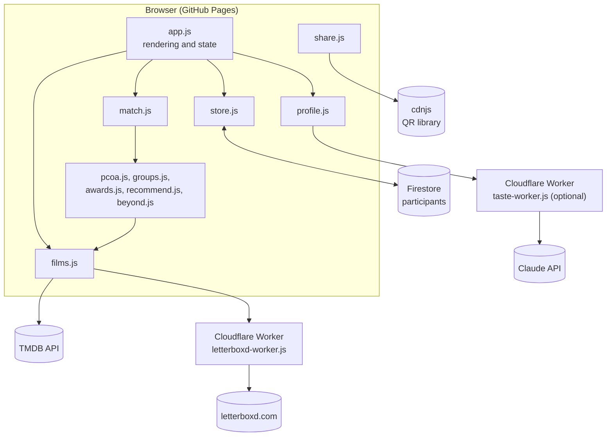

# CineMatch

A class activity. Everyone enters a name and four favorite films, and the page shows who in the room
has similar taste and why. Entries are shared live, so the results fill in as people join.

**Live site:** https://silaspa123.github.io/class-cinematch/

It is a static site (HTML, CSS and JavaScript modules) with no build step and no server of its own.
Three outside services do the work a server would normally do:

| Service | What it is used for | Where the code talks to it |
|---|---|---|
| [TMDB](https://www.themoviedb.org/) | Film search, posters, metadata, recommendations | `films.js` |
| Firebase (Firestore + anonymous sign-in) | The shared list of entries, updated live | `store.js`, `firestore.rules` |
| Cloudflare Workers | Reading Letterboxd favorites; optional AI taste profiles | `worker/` |

This product uses the TMDB API but is not endorsed or certified by TMDB.

## Contents

- [What the page does](#what-the-page-does)
- [How the pieces fit together](#how-the-pieces-fit-together)
- [The data model](#the-data-model)
- [Modules](#modules)
- [How the match score works](#how-the-match-score-works)
- [Security model](#security-model)
- [Configuration](#configuration)
- [Running it locally](#running-it-locally)
- [Deploying](#deploying)
- [Running the activity](#running-the-activity)
- [How this version came together](#how-this-version-came-together)
- [Known limits](#known-limits)

## What the page does

1. **Your four favorites.** A person types a name and fills four slots. There are three ways to fill them:
   search by title, click a film in the "popular ones" list, or type a Letterboxd username to bring in the
   four favorites from that profile.
2. **Your movie twins.** After joining, the person sees their closest matches in the class. Each match card
   has a percentage, a one-line summary, the reasons behind the score, both lists side by side, a film to
   "watch together" and a new film from outside the class.
3. **Recommended for you.** Films the closest matches picked, plus films TMDB connects to the person's list.
4. **The class so far.** Class awards, the most picked films, common genres and directors, a taste map of
   the whole class with taste groups, and the three closest pairs.
5. **Share.** A button that opens a large QR code for the page, with the link to copy.

## How the pieces fit together



The flow for one person:

1. `app.js` draws the form. Every film chosen goes through `films.js`, which asks TMDB for the full
   metadata once and returns a plain object.
2. On "Print my ticket", `store.js` signs the browser in anonymously and writes one document
   (`participants/<uid>`) with the name and the four film objects.
3. Firestore pushes the updated collection to every open page. `store.js` hands the list to
   `app.js`, which validates each entry and redraws the results.
4. All scoring happens in the browser, from the metadata already stored in each entry. No further
   API calls are needed for matches, awards, the map or the class recommendations. Only the
   "beyond the class" suggestions and the optional taste profiles make new requests.

Because the metadata travels with each entry, anyone who opens the page can compute everything from
the Firestore collection alone.

## The data model

One document per person, in the `participants` collection. The document id is the person's anonymous
Firebase user id, which is what lets the rules say "you can only write your own entry".

```js
{
  name: "Ana",              // up to 40 characters
  films: [ /* exactly 4 film objects */ ],
  updatedAt: <server timestamp>
}
```

A film object, as built by `getFilm()` in `films.js`:

| Field | Type | Source in TMDB | Used for |
|---|---|---|---|
| `id` | string | movie id | identity, "same film" |
| `title`, `year` | string, number | title, release date | display, decades |
| `poster` | string or null | poster path | images |
| `directors` | up to 3 names | crew with job "Director" | matching, groups |
| `genres` | names | genres | matching, groups, awards |
| `keywords` | up to 12 | keywords | "themes" in matching |
| `countries` | ISO codes | production countries | matching, awards |
| `lang` | code | original language | matching, awards |
| `cast` | top 3 names | cast | matching |
| `overview` | up to 280 characters | overview | tooltips |
| `runtime` | minutes | runtime | stored, not used yet |

## Modules

### `index.html` and `style.css`

The page skeleton and the look. `index.html` holds the hero, the four empty sections that `app.js`
fills (`#form`, `#mine-list`, `#crowd-body`), the static "How the match works" text and the share
dialog. The stylesheet and scripts are loaded with a version in the query string
(`style.css?v=8`, `app.js?v=7`). Raise the number when you change a file, so browsers do not keep
showing a cached copy.

### `config.js`

The only file with settings. See [Configuration](#configuration).

### `app.js`

The conductor. It owns the page state (the people in the class, the viewer's id, the four slots)
and draws everything. The main parts:

- **`h()`** builds DOM elements from data. Text always goes in as text nodes, never as HTML, so a
  name or a film title cannot inject markup.
- **Form:** `renderForm`, `renderSlots`, `searchBox` (search with a 250 ms pause while typing),
  `renderPresets` and `togglePreset` (the popular list), `letterboxdRow` (the import field), and
  `submitEntry` / `removeMine`.
- **Results:** `renderMine` (the viewer's matches), `pairCard` (one match card), `recCard` and
  `appendBeyond` (recommendations), `renderCrowd` (the class section), `tasteMap` (the SVG map) and
  `awardsBlock`.
- **`sim(a, b)`** returns the match percentage for two people and caches it until the class list
  changes. Every analysis module receives this same function, so the map, the groups, the awards
  and the recommendations all agree with the numbers on the match cards.
- **`cleanPerson` and `cleanFilm`** validate every entry that arrives from the database before it is
  used. See [Security model](#security-model).
- **`onPeople`** is the callback that runs each time Firestore sends a new list. It validates,
  clears the score cache, fills the form with the viewer's saved entry the first time it appears,
  and redraws.

Slow parts of a match card (TMDB suggestions, taste profiles) load only when the card is opened.

### `films.js`

Everything that touches TMDB or Letterboxd.

- `searchFilms(query)` returns up to six light results (`id`, `title`, `year`, `poster`) for the
  search box.
- `getFilm(stub)` fetches the full metadata for one film in a single request
  (`append_to_response=credits,keywords`) and returns the film object described above.
- `resolvePreset(title, year)` turns an entry from the popular list into a TMDB film by searching
  for the title with the year. The list stores titles, not ids, so nothing goes stale.
- `importLetterboxd(username)` calls the Letterboxd Worker, gets four `{title, year}` pairs and
  resolves each one through `resolvePreset` and `getFilm`. It returns the films it found and the
  titles it could not match. A username, `@username` or a profile URL all work.
- `tmdbRecs(id)` returns the films TMDB recommends for one film (falling back to "similar"), cached
  per film.
- `posterUrl(film, size)` builds the image address.

Requests are made in English (`en-US`). The key can be a v3 API key or a v4 read token; the module
detects which one it has.

### `store.js`

One interface, two implementations, chosen by whether `FIREBASE_CONFIG` is set:

```js
store.mode            // "firebase" or "demo"
store.ready()         // resolves with the viewer's id
store.subscribe(cb)   // cb(list) now and on every change
store.save({ name, films })
store.remove()
```

- **Firebase mode** loads the Firebase SDK (10.12.2) from Google's CDN when needed, signs in
  anonymously, listens to the `participants` collection with `onSnapshot`, and writes the viewer's
  document under their own user id.
- **Demo mode** keeps everything in the browser's `localStorage` and starts with the made-up people
  from `demo.js`. Nothing is shared. It exists so the site can be tried without any accounts.

The rest of the code never knows which one is running.

### `match.js`

The scoring. `compare(a, b, mine)` returns the percentage, the raw points, a list of reasons in
plain English, a one-line summary and the films both people picked. `mine` switches the wording
between "You both..." (the viewer's own card) and "They both..." (pairs in the class section).
`allPairs(people)` compares everyone with everyone and sorts by score. Details in
[How the match score works](#how-the-match-score-works).

### `presets.js`

The popular list: 58 films in six groups, as `[title, year]` pairs.

### `demo.js`

A catalog of 30 films with hand-written metadata and six fictional people. Used only in demo mode
and when no TMDB key is set.

### `pcoa.js`

Principal coordinates analysis (classical multidimensional scaling), written from scratch. It takes
the distance matrix of the class, where the distance between two people is `1 - match / 100`,
applies Gower's centering, finds eigenvalues with a Jacobi solver and returns two coordinates per
person plus the share of variation each axis shows. `app.js` draws these as the taste map, using
the same scale on both axes so distances on screen stay faithful. It needs at least three people.
Eigenvector signs are fixed so the map does not flip as people join.

### `groups.js`

Taste groups on the same distance matrix. `tasteGroups(D)` runs average-linkage (UPGMA)
hierarchical clustering, tries every cut from two to six groups and keeps the one with the highest
mean silhouette. If even the best cut is weak (silhouette below 0.15), it reports no groups and the
page says so. It needs at least four people. `describeGroup(people)` finds what a group shares
(top genres, directors picked by two or more members, the most common decade), which `app.js`
turns into names like "The drama crowd".

### `awards.js`

`classAwards(people, sim)` computes six superlatives once three people have joined: Taste twins
(the closest pair), Most mainstream (highest average match with everyone), Wild card (lowest), Time
traveler (oldest films on average), Globetrotter (most countries and non-English languages) and
Genre explorer (most genres). Ties share the award.

### `recommend.js`

Recommendations from the class's own lists.

- `recommendFor(me, people, sim)` scores every film the viewer did not pick by adding up the match
  percentage of each person who picked it. Films loved by the people most like you rise to the top.
- `recommendForPair(a, b, people, sim)` finds one film for two people to watch together: something
  neither picked, backed by people who match both of them at 40% or more.

### `beyond.js`

Recommendations from outside the class, built on `tmdbRecs`. Each seed film votes for the films TMDB
recommends for it, with higher-ranked TMDB results counting more. For one person, the seeds are
their own four films (full weight) plus the films of their two closest matches (weighted by the
match score). For a pair, it prefers a film TMDB links to both lists. Films already on anyone's list
in the class are left out.

### `profile.js` and `worker/taste-worker.js` (optional, off by default)

A two-line description of someone's taste, written by Claude. The browser sends the four films
(title, year, genres, directors) to the Worker, which holds the API key as a secret, calls the
Claude API and caches the answer for that film list. The feature stays hidden while `TASTE_PROXY`
in `config.js` is empty. Setup steps are in `TASTE-PROFILE.md`.

### `share.js`

The share dialog. It draws a QR code for the address the page is open at, so it is correct on any
copy of the site, and offers "Copy link" (and "Send link" on phones). The QR library
(`qrcode-generator` 1.4.4) is loaded from cdnjs only when the dialog is first opened, pinned to that
version and checked with a Subresource Integrity hash. If it fails to load, the link and the copy
button still work.

### `worker/letterboxd-worker.js`

A browser cannot read `letterboxd.com` directly (the site does not allow cross-origin requests), so
this small Worker does it. `GET /?user=<username>` fetches the public profile page, finds the
"favorite films" section and returns up to four `{title, year}` pairs. It stores nothing and caches
answers for ten minutes. Its CORS headers let only the origins listed at the top of the file read
the answer from a browser.
Errors come back as short codes (`invalid_user`, `user_not_found`, `no_favorites`,
`upstream_blocked`), which `app.js` turns into messages.

`worker/dev-proxy.mjs` runs the same Worker code on your machine for testing, and
`worker/wrangler.toml` is the deploy configuration.

### `firestore.rules`

The database rules. See below.

## How the match score works

With four films each, two people rarely pick the same film. So the score adds up several kinds of
overlap between the two lists:

| What is compared | Points |
|---|---|
| Each film both picked | 40 |
| Each director on both lists | 15 |
| Genres | 20 × overlap |
| Themes (TMDB keywords) | 15 × overlap |
| Decades | 10 × overlap |
| Production countries | 8 × overlap |
| Original languages | 4 × overlap |
| Each actor on both lists (up to 3) | 6 |

"Overlap" is the Jaccard index: what the two lists share, divided by everything on either list. It
goes from 0 (nothing shared) to 1 (identical).

The points become a percentage with a curve that rises quickly and then levels off:

```
percentage = 100 × (1 − e^(−points / 55))
```

A shared film is worth about 52% by itself and two are worth about 77%, before counting the genres
and decades that come along with them. A pair with only loose genre overlap lands roughly between
15 and 30%. Every component that scores also adds a sentence to the explanation, so
the number and the reasons always come from the same calculation. The weights are plain numbers
near the top of `compare()` in `match.js`.

## Security model

There is no login and no secret in the site's code, so the protection sits in three places.

**Firestore rules (`firestore.rules`).** Everyone can read the collection. A person can create,
change or delete only the document whose id is their own anonymous user id. A write must have
exactly the fields `name`, `films` and `updatedAt`, a name of 1 to 40 characters and exactly four
films, each one a map with only known fields and a text `id` and `title` within size limits.

The rules are short on purpose. An earlier version checked the type and size of all twelve film
fields, and Firestore rejected valid entries: with four films, the checks went over the limit on
how much one rule may evaluate. If you edit the rules, save a real entry from the site afterwards
to confirm it still goes through.

**Validation on read (`cleanPerson`, `cleanFilm` in `app.js`).** Anything in the database was
written by a browser and cannot be trusted. Before use, every entry is checked and trimmed: wrong
types are dropped, strings and lists are cut to fixed sizes, poster paths must look like TMDB
paths, and an entry without four well-formed films is ignored. A malformed entry cannot break the
page for the rest of the class.

**Workers.** Each Worker has a list of allowed origins. The Letterboxd Worker uses it in its CORS
headers, so pages on other sites cannot read its answers, and it accepts only usernames made of
letters, digits and underscores. It returns public profile data only, so a direct call from a
script gains nothing. The taste Worker refuses requests from other origins, keeps the Claude API
key as a Cloudflare secret, cleans its input and tells the model to treat film data as data. An
origin check does not stop a script that fakes the header, which is why `TASTE-PROFILE.md` asks for
a spend limit on the API key.

What is public by design: the Firebase web config and the TMDB key are visible in `config.js`, as
in any static site. The Firebase config is not a secret (the rules are the protection). The TMDB
key can be replaced in the TMDB dashboard if it is ever abused.

## Configuration

Everything is in `config.js`:

| Setting | Empty means | Filled means |
|---|---|---|
| `FIREBASE_CONFIG` | Demo mode, data only in this browser | Shared live entries |
| `TMDB_KEY` | Search limited to the 30 demo films | Full search, posters, recommendations |
| `LETTERBOXD_PROXY` | No Letterboxd field (except on localhost) | Letterboxd import |
| `TASTE_PROXY` | No AI taste profiles | Taste profiles on match cards |

Step-by-step account setup is in `SETUP.md` (in Portuguese) and `TASTE-PROFILE.md`.

## Running it locally

The site uses JavaScript modules, so it has to be served over HTTP. Opening the file directly does
not work.

```bash
python -m http.server 8765
```

Then open http://localhost:8765. With the real `config.js`, the local page reads and writes the
same database as the live site, so remove any test entry you add.

To test the Letterboxd import without Cloudflare, run the Worker code locally in a second terminal.
On localhost the site uses it automatically.

```bash
node worker/dev-proxy.mjs
```

There is no test suite. `node --check <file>.js` catches syntax errors before a push.

## Deploying

- **Site:** GitHub Pages serves the `main` branch from the repository root. A push to `main` is
  live in about a minute. Remember to raise the `?v=` numbers in `index.html` for changed files.
- **Database rules:** paste `firestore.rules` into the Firebase console (Firestore Database >
  Rules) and publish. Keep the file in the repository identical to what is published.
- **Letterboxd Worker:** from the `worker` folder, after `npx wrangler login`:

  ```bash
  npx wrangler deploy
  ```

- **A fork or a new address:** add the new origin to `ALLOWED_ORIGINS` in both Workers and deploy
  them again. A fork that keeps this `config.js` shares the same database and Workers.

## Running the activity

- Put the site on the projector and press **Share**. The QR code is large enough to scan from the
  back of the room.
- Each person should use their own device. The site recognizes a person by their browser, so two
  people on one phone overwrite each other.
- Someone who closes the page can come back in the same browser and edit or remove their entry.
- To remove an entry as the organizer, delete its document in the Firebase console
  (Firestore Database > `participants`). To start over, delete the collection.
- The taste map needs three people, taste groups need four, and awards need three.

## How this version came together

The project was built in two parts and then joined.

1. **Core and integrations** ([@SilasPA123](https://github.com/SilasPA123)): the form, TMDB search
   and metadata, the popular list, the match score and its explanations, the Firebase store with
   live updates and rules, the Letterboxd Worker, validation of entries, and the share dialog.
2. **Design and analysis** ([@mariamendoza28](https://github.com/mariamendoza28)), developed in a
   fork: the retro movie-poster look and logo, the taste map (PCoA), taste groups, class awards,
   both kinds of recommendations, the "How the match works" section and the optional AI taste
   profiles.

The fork started from the last commit of the core, and the new work was added on top without
changing `store.js`, `match.js`, the rules or the Letterboxd Worker. That made the merge a
fast-forward with no conflicts. The new modules plug in through two narrow points: they receive the
same `sim(a, b)` function the match cards use, and they read the same film objects stored in each
entry. After the merge, the Workers were updated to accept both sites as origins.

## Known limits

- **Scale.** Everything is computed in the browser for every pair of people. It is meant for a
  class, not for hundreds of entries. The page reads at most 500 entries.
- **Letterboxd.** The import reads the public profile page. If Letterboxd changes that page or
  starts blocking Cloudflare, the import stops working and the page asks people to pick films by
  hand.
- **Same film, different entry.** Two people match on a film only if they chose the same TMDB
  entry. Remakes and re-releases with different ids count as different films.
- **Explanations are rule-based.** The reasons on a match card are built from templates, so similar
  pairs get similar sentences.
- **No moderation tools on the page.** Names are free text. The organizer removes entries in the
  Firebase console.
